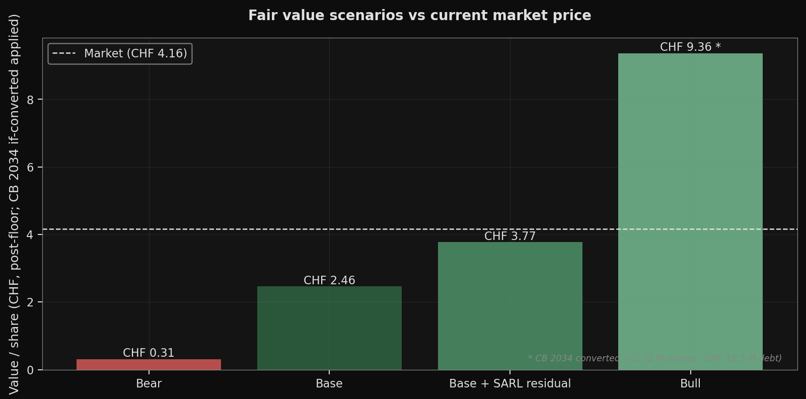
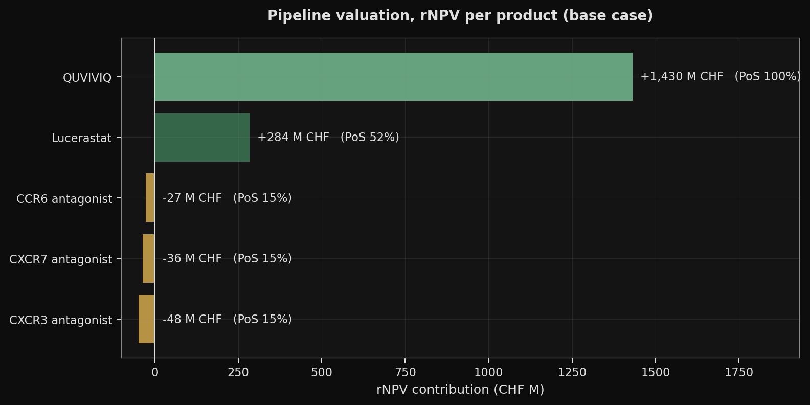
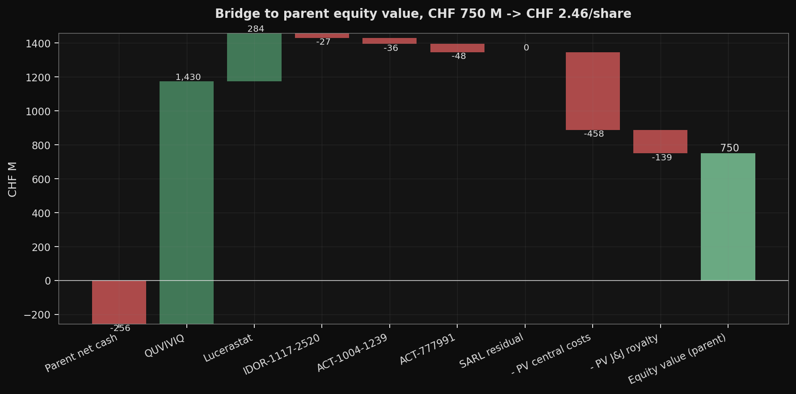
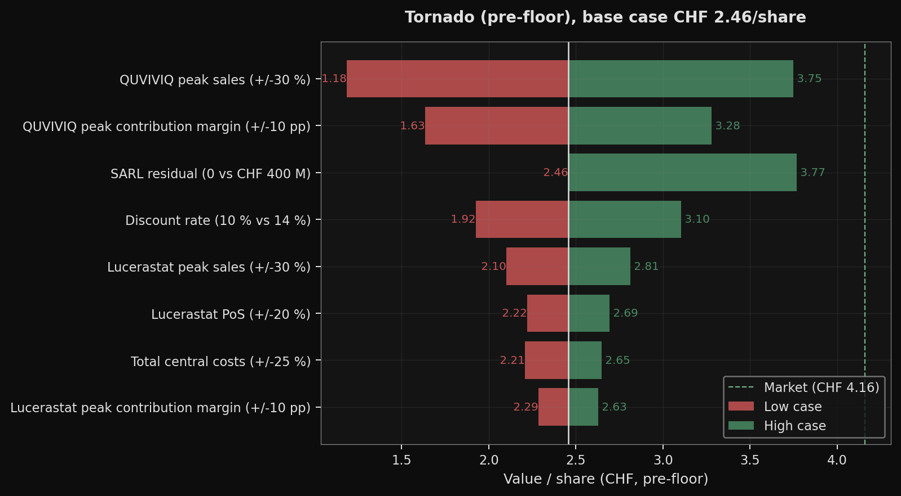
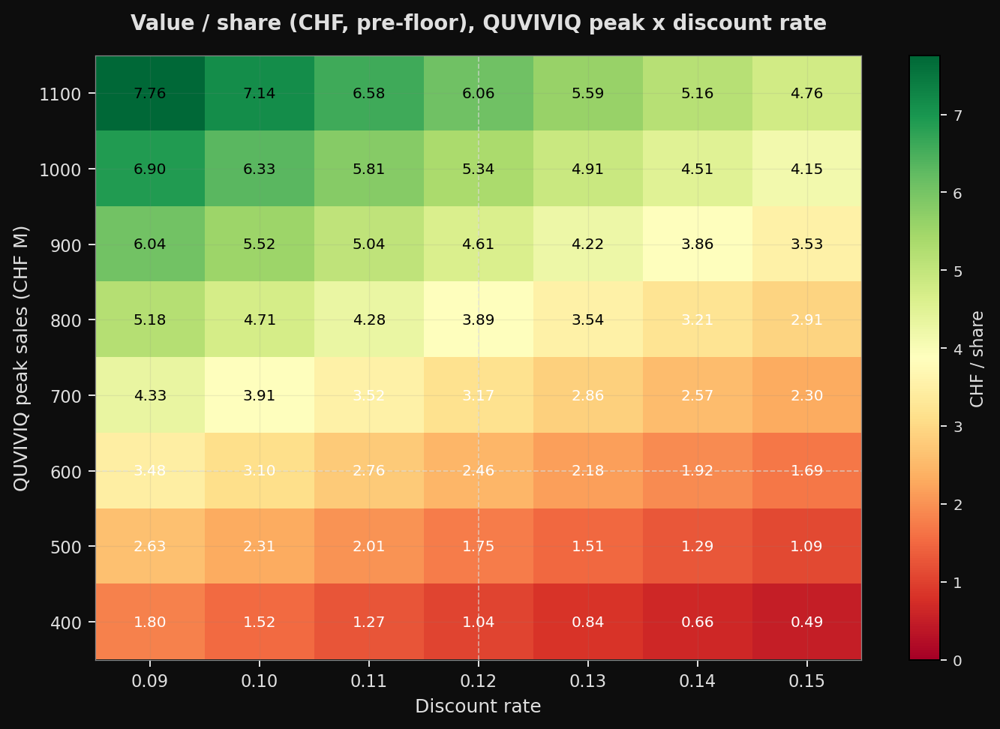

```{python}
#| echo: false
#| output: false
# Primary computation block - all numbers below come from this.
import pandas as pd
import numpy as np
from src import rnpv, assumptions as A
from src import sensitivity as S

BRIDGE = rnpv.value_per_share()
SCENARIOS = S.scenarios()
BASE = BRIDGE["value_per_share_chf"]
BASE_RAW = BRIDGE["value_per_share_raw_chf"]
MARKET = BRIDGE["market_price_chf"]
MARKET_AS_OF = BRIDGE["market_price_as_of"]

# Pre-conversion scenario values (what the bar heights show in the figure)
BEAR = float(SCENARIOS.loc[SCENARIOS["scenario"] == "Bear", "value_per_share"].iloc[0])
BASE_SARL = float(SCENARIOS.loc[SCENARIOS["scenario"] == "Base + SARL residual", "value_per_share"].iloc[0])
BULL = float(SCENARIOS.loc[SCENARIOS["scenario"] == "Bull", "value_per_share"].iloc[0])

# Reconciled range: min and max across the four scenarios (post-floor, post-if-converted).
RANGE_LO = float(SCENARIOS["value_per_share"].min())
RANGE_HI = float(SCENARIOS["value_per_share"].max())

# Fraction of base->market gap closed by Base+SARL scenario (user-requested replacement for the "two thirds" claim)
GAP_COVERED_SARL = rnpv.gap_covered_pct(BASE_SARL, BASE, MARKET)
```

## TL;DR

::: {.callout-important appearance="minimal"}
**Base case fair value: CHF `{python} f"{BASE:.2f}"` / share (raw and floored, model prints positive).**
Equity value `{python} f"CHF {BRIDGE['equity_value_chf_m']:+,.0f} M"`; current market **CHF `{python} f"{MARKET:.2f}"`** (IDIA.SW close `{python} MARKET_AS_OF`). Valuation date: `{python} f"{A.VALUATION_DATE}"` (mid-year, 30 Jun 2026 balance sheet).

**The gap to the market decomposes into two upside catalysts the base case excludes**: (1) a residual claim on the ring-fenced SARL assets (aprocitentan / selatogrel / cenerimod) that reverts to the parent once the SARL notes are repaid, and (2) a QUVIVIQ trajectory above the CHF `{python} f"{A.PRODUCTS['quviviq']['peak_sales_chf_m']:.0f}"` M base-case peak. The J&J convertible loan (CHF `{python} f"{A.JJ_CONVERTIBLE_PRINCIPAL_REMAINING_CHF_M:.0f}"` M remaining, matures 15 Jun 2027) is **not** an upside: the Pharmakon term loan covenant (H1 Report p.44) forbids cash repayment of a convertible loan, so the remaining principal is treated as a deterministic share issuance of `{python} f"{A.SHARES_JJ_CONVERSION_M:.1f}"` M shares at CHF `{python} f"{A.JJ_CONVERTIBLE_STRIKE_CHF:.2f}"` on maturity. Those shares are already in the valuation denominator (`{python} f"{BRIDGE['shares_m']:.2f}"` M, see §*From cash to equity value*).

**Reconciled fair-value range across scenarios: CHF `{python} f"{RANGE_LO:.2f}"` - `{python} f"{RANGE_HI:.2f}"` / share** (post-floor, with CB 2034 if-converted applied where V/share > CHF `{python} f"{A.CB_2034_STRIKE_CHF:.2f}"`). This is the single range used across all pages of this note.
:::

**Scenario headline numbers**

```{python}
#| echo: false
#| output: asis
rows = []
for _, r in SCENARIOS.iterrows():
    v = r["value_per_share"]
    dist = (v / MARKET - 1.0) * 100.0
    cb = " *" if r.get("cb2034_converted", False) else ""
    rows.append({
        "Scenario": r["scenario"] + cb,
        "Value / share (CHF)": f"{v:.2f}",
        "Distance to market": f"{dist:+.0f} %",
    })
print(pd.DataFrame(rows).to_markdown(index=False))
if SCENARIOS["cb2034_converted"].any():
    print()
    print("\\* CB 2034 if-converted applied: V/share > CHF 6.00 triggers conversion of the CHF 16.5 M principal into 2.72 M shares.")
```

{fig-alt="Fair value scenarios (Bear, Base, Base+SARL, Bull) vs current market price"}

## Pipeline breakdown

QUVIVIQ does virtually all the work in the base case.

{fig-alt="rNPV contribution per product in the base case"}

```{python}
#| echo: false
#| output: asis
rows = []
for v in BRIDGE["products"]:
    rows.append({
        "Product": v.name,
        "Phase": v.phase,
        "PoS": f"{v.pos*100:.1f} %",
        "rNPV (CHF M)": f"{v.rnpv:+,.0f}",
        "PV op CF (CHF M)": f"{v.pv_operating_cf:+,.0f}",
        "PV dev costs (CHF M)": f"{v.pv_dev_costs:+,.0f}",
    })
print(pd.DataFrame(rows).to_markdown(index=False))
```

The three early-stage negative rNPVs reflect the arithmetic of applying a `{python} f"{A.cumulative_pos('phase2')*100:.1f} %"` Phase 2 cumulative-to-approval probability against phase-weighted development costs out to filing. They should be read as *"peak sales placeholder too low vs the phase-weighted dev spend"*, not as *"the programme should be discontinued"*. Phase 2 proof-of-concept readouts (CCR6 Q4 2026, CXCR3 2027, CXCR7 Q2 2028) will reanchor those figures materially in either direction. Current-phase remaining PoC costs are calibrated downward from DiMasi 2016 Phase 2 averages: the H1 2026 Report (p.7) explicitly attributes the 2026 clinical development spend to the late-stage daridorexant and lucerastat programs, so a full-program DiMasi anchor would double-count.

## From cash to equity value

{fig-alt="Bridge from parent net cash to parent equity value to value per share"}

```{python}
#| echo: false
#| output: asis
lines = [
    f"Sum of product rNPVs                                       : CHF {BRIDGE['sum_rnpv_chf_m']:+8,.0f} M",
    f"+ Parent net cash (incl. CHF {A.SHARES_WARRANTS_CASH_IN_CHF_M:.1f} M warrant exercise cash)       : CHF {BRIDGE['parent_net_cash_chf_m']:+8,.0f} M",
    f"+ SARL residual (base = 0)                                  : CHF {BRIDGE['sarl_residual_chf_m']:+8,.0f} M",
    f"- PV central costs (G&A + upstream research)                : CHF {-BRIDGE['central_costs_pv_chf_m']:+8,.0f} M",
    f"- PV J&J residual royalty (4 %, cap CHF 272 M remaining)    : CHF {-BRIDGE['jj_royalty_pv_chf_m']:+8,.0f} M",
    f"= Equity value (parent)                                     : CHF {BRIDGE['equity_value_chf_m']:+8,.0f} M",
    f"Issued shares (30 Jun 2026)                                 :     {BRIDGE['shares_issued_m']:8,.1f} M",
    f"Diluted shares, valuation basis (incl. J&J mandatory,       ",
    f"  warrants, unvested free shares)                           :     {BRIDGE['shares_m']:8,.2f} M",
    f"= Fair value / share (raw)                                  : CHF {BRIDGE['value_per_share_raw_chf']:+8.2f}",
    f"= Fair value / share (floored, limited liability)           : CHF {BRIDGE['value_per_share_chf']:+8.2f}",
]
print("```")
for l in lines:
    print(l)
print("```")
```

**Parent net cash is negative** because we attribute `{python} f"CHF {A.PARENT_ATTRIBUTABLE_DEBT_CHF_M:.0f}"` M of debt to the parent equity holder (Pharmakon term loan `{python} f"{A.DEBT_PHARMAKON_LOAN_CHF_M:.0f}"` + convertible bonds CB 2034 / CB 2038 `{python} f"{A.DEBT_CONVERTIBLE_BONDS_CHF_M:.1f}"` + sale-and-leaseback `{python} f"{A.DEBT_SALE_LEASEBACK_CHF_M:.0f}"`) against `{python} f"CHF {A.PARENT_ATTRIBUTABLE_CASH_CHF_M:.1f}"` M of parent cash (`{python} f"{A.CASH_30JUN2026_CHF_M:.1f}"` M group cash at 30 Jun 2026 as an upper bound, plus `{python} f"{A.SHARES_WARRANTS_CASH_IN_CHF_M:.1f}"` M of warrant exercise cash assumed to flow in since the CHF 1.49 strike is far below any plausible V/share).

**The J&J convertible is NOT in the debt line.** Pharmakon's covenant package (H1 Report p.44) explicitly forbids cash repayment of a convertible loan, so the remaining `{python} f"CHF {A.JJ_CONVERTIBLE_PRINCIPAL_REMAINING_CHF_M:.0f}"` M will be settled in shares at CHF `{python} f"{A.JJ_CONVERTIBLE_STRIKE_CHF:.2f}"` on 15 Jun 2027. The `{python} f"{A.SHARES_JJ_CONVERSION_M:.1f}"` M new shares are added to the valuation denominator; the convertible contributes neither debt nor an if-converted test.

**The CHF `{python} f"{A.DEBT_NOTES_SARL_CHF_M:.0f}"` M of SARL notes are excluded from the parent bridge** because they are serviced by the ring-fenced SARL assets. The A1 / A2 tranches carry a *limited and subordinated* guarantee from Idorsia Ltd (H1 p.17, p.41); the term "non-recourse" is therefore inaccurate and avoided. The subordinated-guarantee exposure is flagged in *Limitations* and in [Methodology](methodology.qmd).

The SARL New Money Facility (CHF 78 M drawn at YE 2025, CHF 113 M of principal repaid 25 Jun 2026 using Pharmakon proceeds) is at zero at the valuation date and does not appear in the current debt line.

## Key assumptions and sources

**Every input is either sourced to a public document (`sourced`) or explicitly flagged as an assumption or placeholder.** The audit list of placeholders lives in [`TODO_DATA.md`](https://github.com/DimitriPr/rnpv-idorsia-valuation/blob/main/TODO_DATA.md); the `status` column below is the per-input tag.

```{python}
#| echo: false
#| output: asis
df = pd.DataFrame(A.key_assumptions())
# Reorder columns for display
df = df[["input", "value", "status", "source"]]
df.columns = ["Input", "Base case", "Status", "Source"]
print(df.to_markdown(index=False))
```

Peak sales for QUVIVIQ and lucerastat are **triangulated against public comparables and company disclosure**, not constructed from a bottom-up patient x penetration x price breakdown. Idorsia does not publish the inputs for that calculation, so we use the comparables approach and document each anchor in the product entry.

## What the valuation rides on

{fig-alt="Tornado chart of variables ranked by impact on value per share"}

```{python}
#| echo: false
#| output: asis
TORNADO = S.tornado_data().sort_values("swing", ascending=False).reset_index(drop=True)
_top = TORNADO.iloc[:2]
_mid = TORNADO.iloc[2:4]
_bot = TORNADO.iloc[4:]

def _f(v):
    return f"CHF {v:.2f}"

def _row_desc(r):
    return f"**{r['variable']}** (swing {_f(abs(r['high'] - r['low']))}; low {_f(r['low'])}, high {_f(r['high'])})"

print(f"The dominant levers in the base case are {_row_desc(_top.iloc[0])} and {_row_desc(_top.iloc[1])}.")
print()
if len(_mid) > 0:
    print(f"Mid-tier levers: {'; '.join(_row_desc(r) for _, r in _mid.iterrows())}.")
    print()
if len(_bot) > 0:
    print(f"Minor levers (not sufficient to move the needle on their own): {'; '.join(_row_desc(r) for _, r in _bot.iterrows())}.")
    print()
_max_high = TORNADO["high"].max()
if _max_high < MARKET:
    print(f"**Critical read**: no single variable at its stress case reaches the current market price of CHF {MARKET:.2f}. Closing the gap requires multiple positive assumptions simultaneously, that is the market's implicit bet.")
else:
    _crosser = TORNADO[TORNADO["high"] >= MARKET].iloc[0]["variable"]
    print(f"**Critical read**: at least one variable (*{_crosser}*) reaches the current market price (CHF {MARKET:.2f}) at its stress case, so a single lever can bridge the gap without compounding.")
```

{fig-alt="Value-per-share heatmap over QUVIVIQ peak sales and discount rate"}

### DEA Schedule V update (not full descheduling)

On 11 Aug 2026, the DEA proposed to **reclassify DORAs (QUVIVIQ, Belsomra, Dayvigo) from Schedule IV to Schedule V**, not a full descheduling. Schedule V is the least-restrictive controlled substances tier (looser prescribing / refill constraints) but still a scheduled drug, so prescriber dispensing frictions are reduced without being eliminated. The upside scenarios in this note treat the reclassification as a *modest* commercial accelerator, not as a transformational catalyst. Source: [Marktpuls, Aug 2026](https://www.marktpuls.ch/artikel/permalink/675639).

### QUVIVIQ growth trajectory

```{python}
#| echo: false
#| output: asis
hist = A.PRODUCTS["quviviq"]["historical_sales_chf_m"]
years = sorted(hist.keys())
growth_rows = []
for i, y in enumerate(years):
    if i == 0:
        growth_rows.append({"Year": y, "Net sales (CHF M)": hist[y], "YoY growth": "-"})
    else:
        g = (hist[y] / hist[years[i-1]] - 1.0) * 100.0
        growth_rows.append({"Year": y, "Net sales (CHF M)": hist[y], "YoY growth": f"{g:+.0f} %"})
print(pd.DataFrame(growth_rows).to_markdown(index=False))
```

Realised and guided QUVIVIQ growth is **not** a steady "~+50 % YoY" - it decelerated materially from +120 % (2024->2025) to +49 % guided (2025->2026). To reach the CHF `{python} f"{A.PRODUCTS['quviviq']['peak_sales_chf_m']:.0f}"` M peak by 2030 (an 8-year ramp from launch), 2026->2030 only needs ~`{python} f"{((A.PRODUCTS['quviviq']['peak_sales_chf_m']/200)**(1/4)-1)*100:.0f}"` % annual CAGR, which is consistent with growth decelerating further as the US DORA class matures and the EU reimbursement footprint fills in.

## Scenarios

```{python}
#| echo: false
#| output: asis
rows = []
for _, r in SCENARIOS.iterrows():
    rows.append({
        "Scenario": r["scenario"],
        "V/share pre if-converted (CHF)": f"{r['value_per_share_pre_conversion']:.2f}",
        "V/share post if-converted (CHF)": f"{r['value_per_share']:.2f}",
        "CB 2034 converted?": "yes" if r["cb2034_converted"] else "no",
    })
print(pd.DataFrame(rows).to_markdown(index=False))
```

**Fraction of the base-to-market gap closed by Base + SARL residual**: `{python} f"{GAP_COVERED_SARL:.0f}"` %. The remaining distance is a joint bet on upside QUVIVIQ trajectory, a thicker SARL residual than CHF 400 M, and a lower discount rate than 12 %.

The CB 2034 if-converted test triggers in the Bull scenario (V/share > CHF `{python} f"{A.CB_2034_STRIKE_CHF:.2f}"`), adding `{python} f"{A.SHARES_CB_2034_IFCONVERTED_M:.2f}"` M shares and removing CHF `{python} f"{A.DEBT_CB_2034_CHF_M:.1f}"` M of debt. CB 2038 (strike CHF 31.54) stays out of the money across every scenario.

## Verdict

The v1.2 base case prints CHF `{python} f"{BASE:.2f}"` / share. Equity value at the parent is `{python} f"CHF {BRIDGE['equity_value_chf_m']:+,.0f} M"`, built from `{python} f"CHF {BRIDGE['sum_rnpv_chf_m']:+,.0f}"` M of PoS-weighted product rNPVs minus `{python} f"CHF {BRIDGE['central_costs_pv_chf_m']:,.0f}"` M of PV central costs, `{python} f"CHF {BRIDGE['jj_royalty_pv_chf_m']:,.0f}"` M of PV J&J residual royalty, and `{python} f"CHF {-BRIDGE['parent_net_cash_chf_m']:,.0f}"` M of parent net debt (Pharmakon + CB 2034/2038 + sale-and-leaseback, net of CHF `{python} f"{A.PARENT_ATTRIBUTABLE_CASH_CHF_M:.1f}"` M of cash incl. warrant proceeds). The valuation denominator is `{python} f"{BRIDGE['shares_m']:.2f}"` M shares (issued + J&J mandatory + warrants + unvested free shares).

**The base case is a lower bound, not a price target.** The CHF `{python} f"{MARKET - BASE:.2f}"` gap between the model (CHF `{python} f"{BASE:.2f}"`) and the market (CHF `{python} f"{MARKET:.2f}"`) is a compound bet on three excluded or stressed items:

- **SARL residual.** The ring-fenced subsidiary holds aprocitentan (TRYVIO/JERAYGO), selatogrel and cenerimod. Rights revert to the parent only after the CHF `{python} f"{A.DEBT_NOTES_SARL_CHF_M:.0f}"` M of SARL notes (maturities 2048/2050, PIK interest) are repaid. The reversion is deep out of the money at the valuation date and set to zero in the base case; stressing it to CHF 400 M (Base + SARL scenario) closes `{python} f"{GAP_COVERED_SARL:.0f}"` % of the gap.
- **QUVIVIQ trajectory.** The CHF `{python} f"{A.PRODUCTS['quviviq']['peak_sales_chf_m']:.0f}"` M base-case peak is anchored on Belsomra / Dayvigo comparables and GlobalData's 7MM DORA forecast. A CHF 1,000 M peak (Bull scenario) is defensible under combined DEA Schedule V + pediatric approval + full EU reimbursement; it is not the central scenario.
- **QUVIVIQ peak contribution margin.** The base case uses 55 % contribution margin at peak (COGS 12-20 %, Selling 25-30 % at maturity), interpolated from the H1 2026 sourced anchor of 9 %. Each +10 pp at peak is worth roughly CHF +0.80 / share.

**Reconciled fair-value range CHF `{python} f"{RANGE_LO:.2f}"` - `{python} f"{RANGE_HI:.2f}"` / share** across Bear / Base / Base+SARL / Bull. The market sits inside this range (between Base and Base + SARL), so IDIA is not materially mispriced relative to the model's upside optionality; it is priced for a non-trivial probability that at least one of the three catalysts delivers.

**My reconciled personal read.** At CHF `{python} f"{MARKET:.2f}"`, IDIA is priced for a composite where (a) QUVIVIQ clears CHF 700-800 M of Idorsia-recognised peak sales, (b) the SARL residual accretes toward CHF 400-600 M, and (c) the Pharmakon loan does not need to be extended on worse terms before Q4 2027 QUVIVIQ-driven cash generation turns positive. Each of these is probabilistic. The investable read is a **conditional long on specific catalyst delivery** (CCR6 PoC Q4 2026, QUVIVIQ US run-rate exit 2026, pediatric filing, SARL cash-flow disclosures), with a limited margin of safety at the current level under the base case.

Don't read the point estimate as a price target. Read the status column (sourced / assumption / placeholder) of each input, the four scenarios, and the gap-covered percentage. Every assumption is traceable; every scenario has an explicit narrative.

## Limitations

- **rNPV is an order-of-magnitude tool, not a precise valuation.** Even under corrected method, a +/-10 pp swing on QUVIVIQ peak contribution margin moves per-share value by roughly CHF 0.80.
- **Phase 2 peak sales (CCR6, CXCR7, CXCR3) are placeholders** and drive their negative rNPVs. A positive CCR6 PoC readout at Q4 2026 would reanchor those figures materially. Current-phase remaining costs are calibrated to the 2026 non-GAAP guidance decomposition rather than DiMasi full-program averages (H1 p.7 attributes 2026 clinical dev to late-stage daridorexant and lucerastat).
- **Pharmakon term loan covenants are modelled only at the funding level** (CHF `{python} f"{A.DEBT_PHARMAKON_LOAN_CHF_M:.0f}"` M at 7 % with quarterly amortisation from 30 Sep 2029 and final maturity 25 Jun 2031). The covenant package includes a minimum-liquidity test, a minimum-revenue test, and an *obligation to strengthen liquidity within an agreed timeframe* (H1 p.44), i.e. an implicit requirement for an equity raise before 2028. The dilution that will follow is **not** in the share count.
- **The J&J convertible is treated as a deterministic share issuance**, not debt. The Pharmakon covenant forbids cash repayment of a convertible loan, so the CHF `{python} f"{A.JJ_CONVERTIBLE_PRINCIPAL_REMAINING_CHF_M:.0f}"` M remaining is settled in shares at CHF `{python} f"{A.JJ_CONVERTIBLE_STRIKE_CHF:.2f}"` on 15 Jun 2027. The `{python} f"{A.SHARES_JJ_CONVERSION_M:.1f}"` M new shares are already in the diluted valuation basis.
- **SARL note A1 / A2 carry a limited and subordinated guarantee from Idorsia Ltd** (H1 p.17, p.41). The base case excludes any claim on IDIA shareholders in a SARL stress scenario; this is a conservative assumption that could reverse in a downside case. The term "non-recourse" is factually incorrect for notes A and is not used in this note.
- **The J&J residual royalty is a central line, not a per-product haircut.** The disclosure (H1 note 4, p.32) is "low-to-mid single-digit on net sales of all Idorsia products, until the remaining cap is reached". We model 4 % with a cap of CHF `{python} f"{A.JJ_RESIDUAL_ROYALTY_CAP_REMAINING_CHF_M:.0f}"` M, applied to the PoS-weighted aggregate sales stream. Rate and allocation ratio across products are both assumptions; the cap and the mechanic are sourced.
- **Ex-US / ex-EU partner economics are not modelled.** Mochida (Japan), Simcere (China) and Idorsia Korea generate milestones and royalties on QUVIVIQ outside Idorsia's directly-recognised net sales. These are a small addition today (contract revenue line of the H1 2026 non-GAAP P&L: CHF 8 M, annualised ~16 M) and are not projected forward in the base case.
- **Central costs** (`{python} f"CHF {A.CENTRAL_COSTS_GA_YEAR_1_CHF_M:.0f}"` M G&A + `{python} f"{A.CENTRAL_COSTS_UPSTREAM_YEAR_1_CHF_M:.0f}"` M upstream research in year 1, both sourced on H1 2026) are modelled as a decline-then-floor-then-proportional curve, decay 10 % / year to a floor of CHF `{python} f"{A.CENTRAL_COSTS_FLOOR_CHF_M:.0f}"` M by 2040, then scaled by weighted revenue to 2050 with a hard floor of CHF `{python} f"{A.CENTRAL_COSTS_TAIL_FLOOR_CHF_M:.0f}"` M. Not a line-by-line projection.
- **Upstream research is deducted but no value is attributed to the unborn pipeline candidates** it will generate. Downward bias of unknown magnitude.
- **QUVIVIQ post-launch R&D** (pediatric programme, label extensions) is not modelled as a separate product. The 2026 development spend is calibrated such that it implicitly covers that lifecycle R&D.
- **Working capital and capex are netted to zero**; tax is proxied by the operating margin; product outcomes are assumed independent (no portfolio effect).
- All historical data and the current share price are pinned to specific dates (`data/market.json` for the quote via `scripts/update_price.py`; `{python} f"A.VALUATION_DATE = {A.VALUATION_DATE}"` for the balance sheet). Re-run the price refresh before each deploy.

---

*Full computation trail: [interactive notebook](notebook.qmd) | [methodology](methodology.qmd) | [source on GitHub](https://github.com/DimitriPr/rnpv-idorsia-valuation).*
